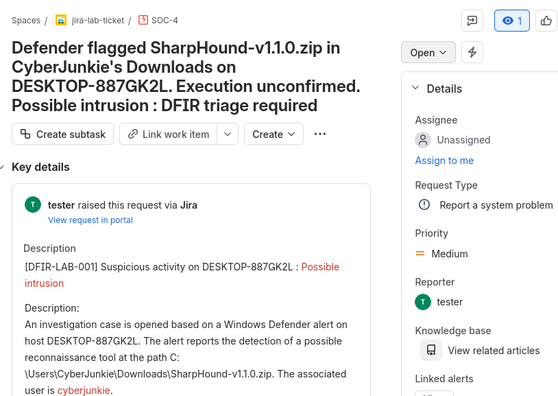

# Windows Event Log Investigation — HTB Logjammer

Hello, I'm Joel, in this case I'll take the role as a DFIR (Digital Forensics and Incident Response), this lab focused on analysing Windows Event Logs, documenting, so I'm gonna supporting evidence, and explaining the security implications of observed activity.

The investigation is tracked in Jira and documented through
reproducible searches, relevant screenshots, and evidence references.

## Scenario

Forela-Security has provided a technical assessment for a DFIR consultant role. The assessment requires examining supplied Windows Event Logs and answering questions about the activity recorded in those artifacts.

This htb project documents my investigation process, including how I locate relevant events, interpret their fields, and distinguish confirmed observations based in my hypothesis.

## Ticket Jira

The ticket is reviewed in Jira, ownership is taken, and the investigation begins. The directory containing the log files is downloaded and ingested into Splunk for analysis.

