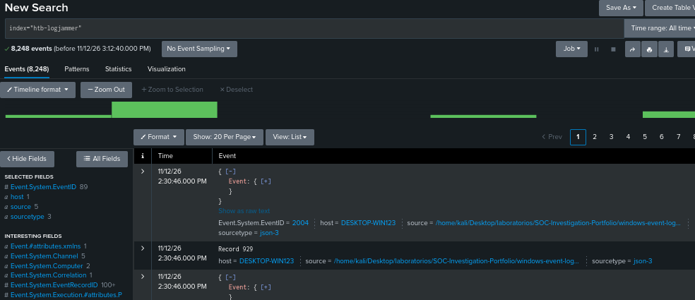
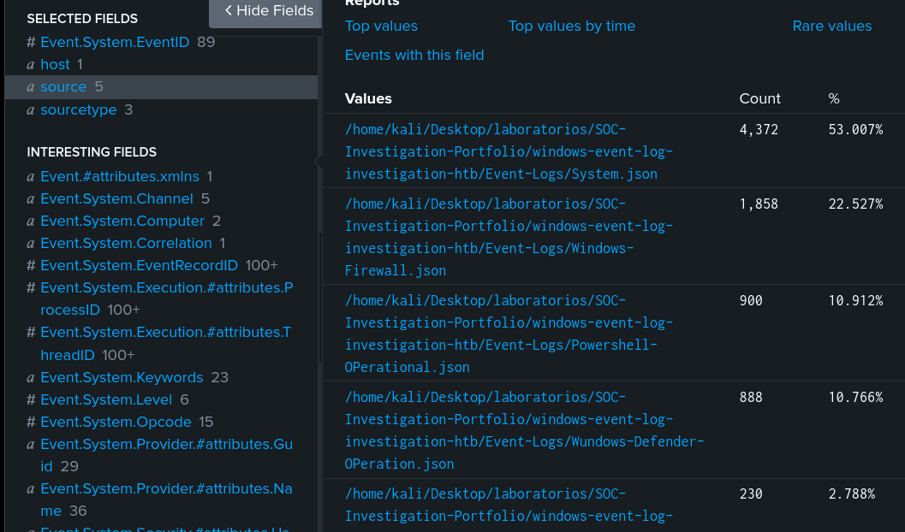
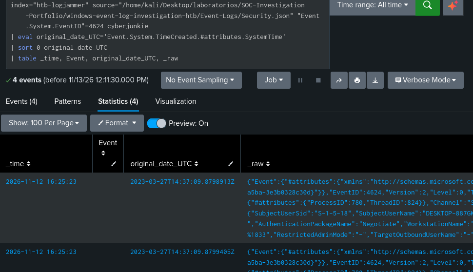
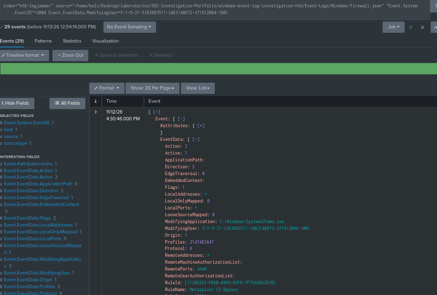
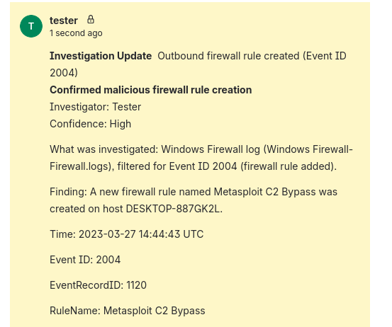
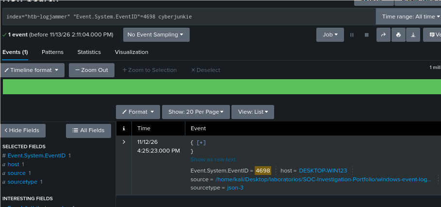
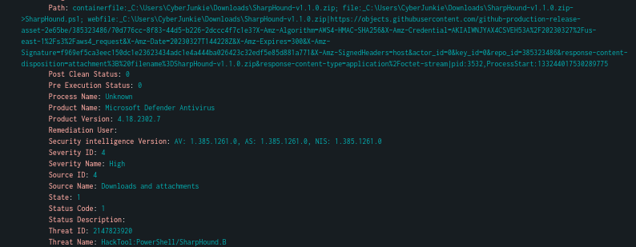
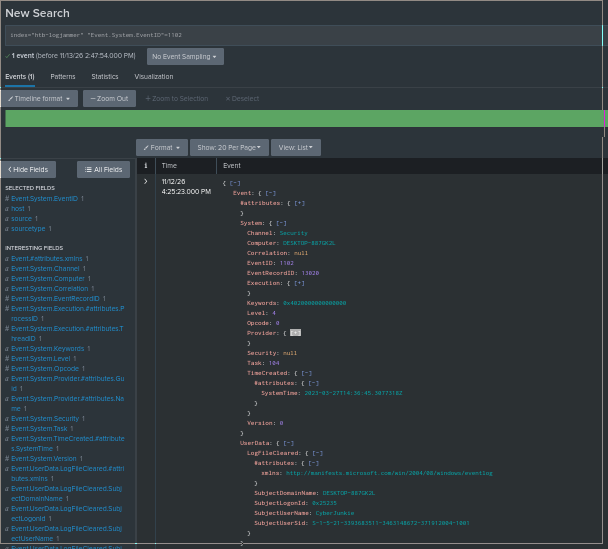
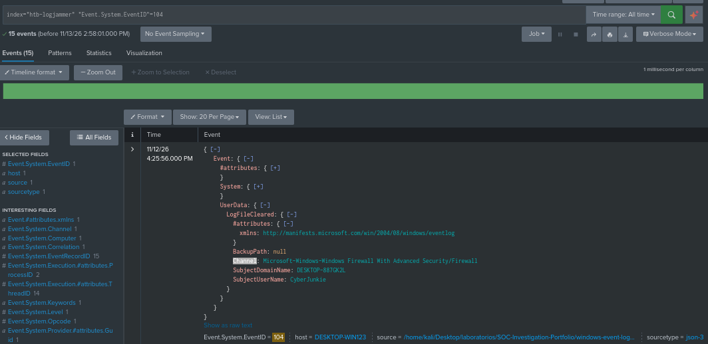

# Windows Event Log Investigation — HTB Logjammer

Hello, I'm Joel, in this case I'll take the role as a DFIR (Digital Forensics and Incident Response), this lab focused on analysing Windows Event Logs, documenting, so I'm gonna supporting evidence, and explaining the security implications of observed activity.

The investigation is tracked in Jira and documented through
reproducible searches, relevant screenshots, and evidence references.

## Scenario

Forela-Security has provided a technical assessment for a DFIR consultant role. The assessment requires examining supplied Windows Event Logs and answering questions about the activity recorded in those artifacts.

This htb project documents my investigation process, including how I locate relevant events, interpret their fields, and distinguish confirmed observations based in my hypothesis.

## Investigation Objectives

- Identify the evidence relevant to the htb questions.
- Examine recorded user activity and system configuration changes.
- Analyse relevant Security, System, PowerShell, Windows Defender,
  and Windows Firewall events.
- Correlate related events where shared identifiers and context
  support the relationship.
- Build a timeline of relevant observations.

## Ticket Jira

The ticket is reviewed in Jira, ownership is taken, and the investigation begins. The directory containing the log files is downloaded and ingested into Splunk for analysis.




## Validate logs in Splunk

I ingest these `.evtx` log files into Splunk in JSON format. At this point I change the time to UTC time.
As I know, the suspicious user is `cyberjunkie` and I'm dealing with Windows event logs.
So I'll start looking for event ID `4624`, which means a successful logon attempt.

Important note: Windows event IDs are not unique, and since I'm working with multiple log sources, I'll be interested in Security logs for this purpose.



In my case, the event code I'm interested in has the name `Event.System.EventID`. So I got 67 events with code 4624, but if I filter by `cyberjunkie` I receive 4 events, and most importantly, I got this first successful logon attempt from `cyberjunkie` at `27/03/2023 14:37:09`.



## Bypass defenses and persistence

At this point I need to understand how it bypassed the defense system, so manually I'll look for event codes in the Windows Firewall logs. For example, event code `2004` means a rule was added to the firewall. I got `490` such events, but I can't say that the user `cyberjunkie` did it. However, filtering by `userId` I got `29` added events from this user, so I can confirm that `cyberjunkie` is responsible for making these changes to the firewall rules.



So looking in the logs, the rule name that had been added was `Metasploit C2 Bypass` on `2023-03-27 14:44:43`, and the direction is `2`, which means `Outbound`.

So with this information I'll update the Jira ticket with the new information, to share it with my "team".



By looking at this event `Event ID 4719` I only found one. This event means that the audit policy had changed, at `2023-03-27 14:50:03`. I can note that the `SubcategoryId` is `%%12804`, which means `Other Object Access Events`. Well, this doesn't prove anything, but it caught my attention due to the time at which it was changed. However, it can help to look for a new scheduled task created via the `4698` event code.



Inside this I found the following data:

```xml
<?xml version="1.0" encoding="UTF-16"?>
<Task version="1.2" xmlns="http://schemas.microsoft.com/windows/2004/02/mit/task">
  <RegistrationInfo>
    <Date>2023-03-27T07:51:21.4599985</Date>
    <Author>DESKTOP-887GK2L\CyberJunkie</Author>
    <Description>practice</Description>
    <URI>\HTB-AUTOMATION</URI>
  </RegistrationInfo>
  <Triggers>
    <CalendarTrigger>
      <StartBoundary>2023-03-27T09:00:00</StartBoundary>
      <Enabled>true</Enabled>
      <ScheduleByDay>
        <DaysInterval>1</DaysInterval>
      </ScheduleByDay>
    </CalendarTrigger>
  </Triggers>
  <Principals>
    <Principal id="Author">
      <RunLevel>LeastPrivilege</RunLevel>
      <UserId>DESKTOP-887GK2L\CyberJunkie</UserId>
      <LogonType>InteractiveToken</LogonType>
    </Principal>
  </Principals>
  <Settings>
    <MultipleInstancesPolicy>IgnoreNew</MultipleInstancesPolicy>
    <DisallowStartIfOnBatteries>true</DisallowStartIfOnBatteries>
    <StopIfGoingOnBatteries>true</StopIfGoingOnBatteries>
    <AllowHardTerminate>true</AllowHardTerminate>
    <StartWhenAvailable>false</StartWhenAvailable>
    <RunOnlyIfNetworkAvailable>false</RunOnlyIfNetworkAvailable>
    <IdleSettings>
      <Duration>PT10M</Duration>
      <WaitTimeout>PT1H</WaitTimeout>
      <StopOnIdleEnd>true</StopOnIdleEnd>
      <RestartOnIdle>false</RestartOnIdle>
    </IdleSettings>
    <AllowStartOnDemand>true</AllowStartOnDemand>
    <Enabled>true</Enabled>
    <Hidden>false</Hidden>
    <RunOnlyIfIdle>false</RunOnlyIfIdle>
    <WakeToRun>false</WakeToRun>
    <ExecutionTimeLimit>P3D</ExecutionTimeLimit>
    <Priority>7</Priority>
  </Settings>
  <Actions Context="Author">
    <Exec>
      <Command>C:\Users\CyberJunkie\Desktop\Automation-HTB.ps1</Command>
      <Arguments>-A cyberjunkie@hackthebox.eu</Arguments>
    </Exec>
  </Actions>
</Task>
As you can see, the full path that had been created for the task is C:\Users\CyberJunkie\Desktop\Automation-HTB.ps1, at 2023-03-27 14:51:21, by cyberjunkie. It is a PowerShell script. By looking at the Windows Defender codes to find any malware, I found 139 events with the event code 1116 | MALWAREPROTECTION_STATE_MALWARE_DETECTED. The name of the virus that was detected is called SharpHound, at 2023-03-27T14:42:34.

Searching more deeply, I found that the path of the malware was C:\Users\CyberJunkie\Downloads\SharpHound-v1.1.0.zip.



And by looking at the antivirus event ID 1117, I can confirm that this malware has been put in quarantine. But from my point of view, I'll look for executed PowerShell commands by cyberjunkie.

To take a look at this, I need to see what log providers exist. There are 5; one of these is 
*/PowerShell-Operational.json
. There are 578 events about this. The malicious user tried to run this, but it was blocked: ScriptBlockText: Get-FileHash -Algorithm md5 .\Desktop\Automation-HTB.ps1. At this point I just thought that the attacker could hide their moves, but by looking at event code 1102 I found that the audit log was cleared. So whenever we see an event code of 
1102
, that means the security event log was cleared. However, there is another event log that will be generated if anything other than the security audit log was cleared, and that is event ID 104 under the System log provider. So I'll check for that event ID code too. I have 15 events with this code, and my timeline of interest is on 27/03/2023, so there is one event with these specifications: a log clear for the log provider Microsoft-Windows-Windows Firewall With Advanced Security/Firewall, and this log was cleared at 2023-03-27 15:01:56.




